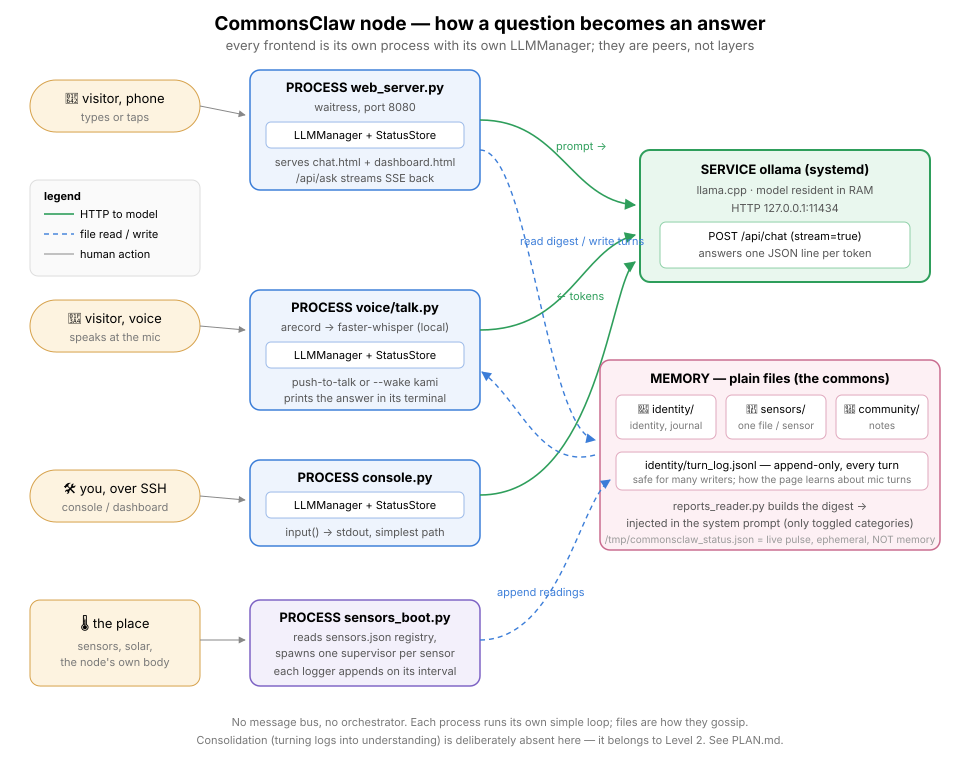

# Architecture — how a question becomes an answer

_A reading guide to the codebase, following one question through the system.
Written 2026-09-26; keep updated as the system evolves._



## 0. The big picture — who is a process, who talks to whom

This is the diagram that matters. **Four kinds of things**: humans, frontend
_processes_, Ollama (the model server, its own systemd service), and plain
files. Every frontend is a **separate process containing its own copy of
`LLMManager`** — there is no central "manager in the middle". Each frontend
calls Ollama directly, as a peer of the others.

```
                        THE ONE MODEL (its own process, always running)
        ┌────────────────────────────────────────────────────────────────┐
        │  Ollama service  (llama.cpp, model loaded in RAM)              │
        │  HTTP API on 127.0.0.1:11434  —  POST /api/chat, streams NDJSON│
        └───────▲──────────────────▲──────────────────▲──────────────────┘
                │ HTTP             │ HTTP             │ HTTP
   ┌────────────┴───────┐ ┌────────┴─────────┐ ┌──────┴───────────────┐
   │ PROCESS:           │ │ PROCESS:         │ │ PROCESS:             │
   │ web_server.py      │ │ console.py       │ │ voice/talk.py        │
   │ (waitress, :8080)  │ │ (SSH terminal)   │ │ (ReSpeaker mic)      │
   │  ├ LLMManager      │ │  ├ LLMManager    │ │  ├ arecord (capture) │
   │  ├ StatusStore ─┐  │ │  ├ StatusStore ─┐│ │  ├ faster-whisper    │
   │  └ Flask routes │  │ │  └ input() loop││ │  ├ LLMManager        │
   └───────▲─────────│──┘ └───────▲────────│┘ │  └ StatusStore ─┐    │
           │ HTTP    │            │ stdin  │  └─────────────────│────┘
           │ /api/*  │            │ stdout │                    │
   ┌───────┴─────────┴──┐         │        │    ┌───────────────▼──────┐
   │ BROWSER (the phone)│         │        │    │ FILE:                │
   │  static/chat.html  │         │        │    │ /tmp/commonsclaw_    │
   │  (JS: fetch+SSE)   │         │        │    │   status.json        │
   └────────────────────┘         │        │    │  "the bulletin board"│
                                  │        │    └───────────▲──────────┘
   ┌────────────────────┐         │        │                │ polled
   │ PROCESS: control.py│ ◄───────┘        │                │
   │ (SSH dashboard)    │ ──reads the bulletin board file───┘
   └────────────────────┘                  │
   ┌────────────────────┐                  │
   │ PROCESSES: loggers/│ (cron, separate) │
   │  sensor_*.py       │ ──append──► sensors/ community/ identity/ (plain .md)
   └────────────────────┘                   ▲
                     ▲                      │ read into every prompt
                     └──────── reports_reader.py (called by each LLMManager)
```

**What flows over which channel:**

| Channel                                       | Kind                  | What crosses it                                 |
| --------------------------------------------- | --------------------- | ----------------------------------------------- |
| browser ↔ `web_server.py`                     | HTTP + SSE            | questions, streamed answers, status, notes      |
| each frontend → Ollama                        | HTTP POST `/api/chat` | the full prompt; NDJSON token stream back       |
| each frontend → status file                   | atomic file write     | "I'm alive, here's my current question/metrics" |
| `control.py`, web `/api/status` ← status file | file read             | the bulletin board (display only!)              |
| loggers → `sensors/` `reports/`               | file append           | sensor readings, notes                          |
| `reports_reader` ← those dirs                 | file read             | memory digest → into the system prompt          |

**The key insight you were missing:** the voice pipeline does NOT go "mic →
manager → browser". `voice/talk.py` is a _frontend_ — it transcribes locally,
calls Ollama itself, and then simply _posts the finished turn on the bulletin
board_. The phone page polls `/api/status` (every 15 s) and _renders_ the
voice turn it finds there. Display, not control.

## The one-paragraph version

A person talks to the kami through one of three frontends, all converging on
the same path: the **web page** (phone/laptop browser — the main one),
**console.py** (typing over SSH), or **lcd_gui.py + main.py** (the original
keyboard + attached-monitor Tkinter GUI). Each frontend hands the question to
`llm_manager.py` — the only file that talks to the model. The LLM manager
assembles a system prompt (personality + active memory categories), POSTs it
to Ollama's `/api/chat` with `stream=True`, and yields each token chunk back
as a generator. The frontend renders chunks as they arrive (SSE to the
browser / stdout in the console / a Tk queue in the GUI). Meanwhile every
frontend also publishes live status (hardware, model metrics, current
question) to a single JSON file via `status_store.py`, which `control.py`
renders over SSH. Separate logger processes (cron) append sensor readings to
plain-text files; those files are read back into the system prompt on the
next question.

## Why the model is a _server_, not an object

A first-timer's question: why does our Python code call the model over HTTP
instead of just importing it as a library/object?

1. **The model is huge and slow to load — load it once, share it.** A
   1–4 GB model takes seconds to load into RAM. If it were an object inside
   each program, every frontend (web, console, GUI) would hold its own copy
   (the Pi would suffocate) and every process restart would pay the load
   cost. Ollama keeps the model warm; our web server restarts on every code
   push and the model never notices.
2. **Anything can talk to it.** The browser page, Python, a cron job, a
   `curl` one-liner — one HTTP POST, no language bindings. (This is exactly
   how `benchmark.py` and my debug probes work.)
3. **It's the field's standard pattern.** Ollama, OpenAI's API, every LLM
   service: same shape. In C++ terms — not a static library linked into every
   binary, but one daemon everyone sends messages to. A model is closer to a
   _database_ than to a library.

The cost is an HTTP round-trip on localhost — microseconds. Nothing.

### Is the model loaded once, or every time?

Neither per-run nor forever, by default. Ollama loads the weights into RAM on
the **first** request and keeps them there for **5 minutes after the last
one**, then evicts (`ollama ps` shows what is resident). That is exactly the
cold/warm gap we measure: ~8.5 s TTFT on the first question after a pause,
~0.8 s while warm. Restarting our Python processes changes nothing — the
model lives in Ollama, not in them.

For an installation that must answer a visitor instantly, eviction is wrong,
so `install_autostart.sh` drops in `OLLAMA_KEEP_ALIVE=-1` (never unload).
Cost: ~1 GB of the Pi's 16 GB held permanently.

## The cast

```
PRESENTATION (per visitor)          CORE (one per process)          THE MODEL
──────────────────────────          ──────────────────────          ─────────
static/chat.html (browser)          llm_manager.py ──────────────►  Ollama
static/dashboard.html                    │   (only file that        (llama.cpp,
console.py  (SSH chat)                   │    talks to the model)    127.0.0.1:11434)
main.py + lcd_gui.py (monitor)           │
                                         ├─ reports_reader.py  ◄── identity/, sensors/, community/
                                         │     (plain-text memory digest into the prompt)
                                         │
                                         ├─ config.py (all settings, one place)
                                         └─ status_store.py ──► /tmp/commonsclaw_status.json
                                                                   ▲ (atomic writes; live pulse,
                                                                     ephemeral — NOT the memory)

SEPARATE PROCESSES                    OPS
─────────────────                     ───
loggers/sensor_*.py (cron)  ──► sensors/ (plain text)   (persistent, plain text)
control.py (SSH dashboard)  ◄── reads the status file
                                  benchmark.py → BENCHMARKS.md
                                  ap_up/portal_up/install_autostart/make_cert/push_to_pi.sh
```

## Following one question (web path)

1. **Browser** — `static/chat.html`: `send()` collects the question, the
   selected model, and the active memory toggles (🧠/📡/📝) and POSTs to
   `/api/ask`. It then reads the response body as a Server-Sent-Events stream
   with a hand-rolled parser (`readSSE`), appending each `chunk` event to the
   transcript. A watchdog covers the "connection died before any chunk" case;
   mid-answer pauses are legal and not treated as errors.

2. **Web server** — `web_server.py`: the `ask` route validates the question,
   resolves memory categories (`toggles + slash keywords + auto-detect` via
   `LLMManager.resolve_categories`), and — under a single-slot lock (the Pi
   can only generate one answer at a time) — streams `_stream_question()`'s
   events back on the _same_ HTTP response. The asker always gets its own
   answer; a second concurrent asker gets a `busy` event. This same process
   also serves `/api/status`, `/api/models`, `/api/note`, the dashboard's
   `/api/files`, and the captive-portal probe answers.

3. **LLM manager** — `llm_manager.py`: `stream_response()` builds the
   message list — system prompt (personality from `config.SYSTEM_PROMPT`
   - the active memory digest from `reports_reader`) + in-RAM conversation
     history + the question — and POSTs to Ollama. Ollama answers with one JSON
     object per line (NDJSON); each `content` chunk is yielded immediately.
     The final line carries Ollama's own counters (prompt tokens, eval count,
     eval duration) → metrics. The turn is then appended to history.

4. **Ollama / llama.cpp** — the actual model (default `llama3.2:1b`), running
   as a systemd service, loaded in RAM, quantized, CPU-only. Two phases per
   request: _prompt evaluation_ (reading everything — dominates wall time
   when the prompt is large) and _generation_ (the tok/s we benchmark).

5. **Status store** — `status_store.py`: alongside the answer path, the web
   server publishes every stage (question submitted, model metrics updates,
   turn completed) to `/tmp/commonsclaw_status.json` using temp-file +
   atomic rename. `control.py` polls it from an SSH session. Ephemeral by
   design — it is a pulse, not a memory.

### The keyboard path (original frontend, still present)

`main.py` + `lcd_gui.py` — the Tkinter GUI from the seed project, used when a
monitor+keyboard is attached. A Tk `Entry` widget captures typing; `<Return>`
calls `on_submit` → `_handle_prompt` → the same
`LLMManager.stream_response()`. Because generation runs in a background
thread and Tk widgets may only be touched from the main thread, chunks cross
through a thread-safe `queue.Queue`; Tk's event loop polls it every 40 ms
(`GUI_STREAM_POLL_MS`) and appends text. On a headless boot `main.py`
auto-falls back to `console.py` instead.

### The console path

`console.py` — plain stdin/stdout over SSH: `input()` → `stream_response()` →
chunks printed with `flush=True`. The simplest frontend; useful when
debugging.

### The voice path

`voice/talk.py` — ReSpeaker mic → `arecord` captures a clip (push-to-talk:
Enter/Enter; wake-word: `--wake kami` listens in 2.5 s windows) →
`faster-whisper` transcribes locally (~1 s) → the same
`LLMManager.stream_response()` → answer printed token by token. Its
`StatusStore` posts the turn to the bulletin board, which is how phones see
voice conversations (see "Following one voice question").

## Loops and events — what runs when

There is **no event bus and no scheduler**. Each process is one plain loop,
and every loop is either _blocked waiting for a human_ or _sleeping on a
timer_. That is the whole concurrency model. Written as pseudocode:

```
web_server.py          voice/talk.py            sensors_boot.py
─────────────          ─────────────            ─────────────
loop forever:          loop forever:            per sensor, loop forever:
  wait for HTTP          wait for Enter/wake       run its logger script
  → answer it            record until pause        sleep(interval_seconds)
                         transcribe
+ a 2nd thread:          ask the model
loop forever:            print the answer        journal_writer.py (cron)
  sample hardware        append to turn_log      ─────────────────
  sleep(15 s)                                    once a day at 23:55:
                       control.py                  read today's logs
the browser page       ──────────                  write one journal block
────────────────       loop forever:
loop forever:            read status file
  GET /api/status        redraw
  sleep(5 s)             sleep(0.5 s)
+ while an answer
  streams: read SSE
  chunks as they come
```

The only "event" in the system is an HTTP request. Everything else is a
timer or a blocking read. Nothing schedules anything else; nothing waits on
another process. If you kill any box above, the others keep running.

## Following one voice question (the part that confused you)

1. You speak at the mic. `voice/talk.py` (its own process) records with
   `arecord`, transcribes with whisper — all local, no model call yet.
2. `talk.py`'s **own** `LLMManager` POSTs the text to Ollama and streams the
   answer, printing it in that terminal. The phone is not involved yet.
3. When the turn completes, `talk.py` appends one JSON line to
   `identity/turn_log.jsonl`, tagged `"source": "voice"`.
4. Within 5 s the phone's page polls `/api/status`; the web server reads the
   **last line of that log** and returns it. (It must be the log, not the
   status file: every frontend rewrites the status file wholesale from its
   own memory, so the web server's 15 s hardware tick would erase a voice
   turn before anyone saw it. Append-only is what makes many writers safe —
   this bug actually happened, 2026-09-28.)
5. The page renders `🎤🙂 question` + `🐢 answer`, deduping on the timestamp
   and skipping turns whose source is `web` (those already streamed in).

So the phone shows the voice conversation **by reading the log**, never by
participating in the model call. If nobody is looking at a phone, the voice
loop is complete without it.
## The memory loop (what makes it a kami)

```
  sensors ──(sensors_boot.py supervisors)──► sensors/sensor_*.md
  people  ──(💾 button: /api/note)─────────► community/notes.md
  everyone─(every completed turn)──────────► identity/turn_log.jsonl
  clock   ──(cron 23:55 journal_writer)────► identity/journal.md
  humans  ──(hand edits)───────────────────► identity/identity.md
        │
        ▼  reports_reader.py digest, filtered by category toggles/keywords
  next question's system prompt
```

The kami reads its world through files and writes nothing itself (yet) —
identity curation stays human-gated on purpose.

## The missing organ: consolidation

Everything above is **accumulation**: logs grow, notes pile up, the journal
gains a block a day. None of it is *understanding*. Consolidation is the step
that turns a month of `temp=27.4C` lines into "the pond runs warm after the
rains, and the children come earlier on those days" — and this node does not
do it.

That is deliberate, not an omission. Consolidation means re-reading a large
body of text and rewriting a small one, which is precisely the workload a
1 B model on a CPU is worst at. A wrong consolidation is also worse than
none: it silently poisons every future answer.

**Where it belongs.** Conceptually this is the kami's own metabolism — a
Level-1 job. Practically the Pi 5 cannot host the model that would do it
well, which is an honest finding about the hardware, not about the design:
_a place-node that must also reflect needs more than a Pi 5, or it must
borrow a bigger mind from Level 2._ The current plan borrows: the journal
format is a handoff, and the neighborhood tier (Level 2) reads many kami's
journals and writes back.

**How OpenClaw does it** (verified 2026-09-28, see
[OPENCLAW_MEMORY_RESEARCH.md](OPENCLAW_MEMORY_RESEARCH.md)) — the most
mature file-based implementation to learn from:

- Memory is plain Markdown in a workspace: `MEMORY.md` (curated core),
  `USER.md` (capped at 4k), `memory/YYYY-MM-DD.md` (episodic). SQLite holds
  only a derived index (FTS5 + vectors), never the source of truth.
- Consolidation is a nightly cron sweep they call **"dreaming"** (default
  `0 3 * * *`), in three phases — light → REM → deep — and only the deep
  phase may rewrite the curated core.
- Promotion is gated by a **deterministic score** (relevance, frequency,
  query diversity, recency, consolidation, richness) computed *before* any
  model call — the model is asked only about what already passed the gate.
- The model returns **merge/supersede operations, not prose**, validated
  against a ≤25% prior-entry-loss rule, mandatory `Source:` anchors, and a
  budget; failure falls back to plain append. Writes are atomic renames.
- Retrieval at inference is hybrid: always-on injection of the curated tier
  plus ranked search (`relevance × recency decay × importance`), with **zero
  query-time model calls** — cheap by construction.

**What we would borrow, and what we cannot.** The deterministic gate before
the model call, operations-not-prose, the loss-bounded validation, atomic
writes, and `Source:` provenance are all directly applicable and cheap — they
are the reason their consolidation is trustworthy. What does *not* transfer:
OpenClaw scopes memory **per agent, per user** — a gateway is explicitly "one
trust domain", and group/channel sessions are *excluded* from durable
memory. There is no notion of a place, and no notion of many authors writing
one shared identity. That gap is exactly the problem CommonsClaw exists to
solve, so the communal half (whose voice counts, how a commons avoids being
captured by its loudest visitor) has to be invented here.

## Design rules worth knowing before changing anything

- **One model door**: only `llm_manager.py` talks to Ollama. Frontends never do.
- **Files are the memory**: plain markdown, readable by humans, cron, and the
  LLM. No database, no broker, no MCP server (yet — the format is MCP-ready).
- **Append-only for anything many processes write** (`turn_log.jsonl`).
  Whole-document writes are single-writer only (the status file) — mixing
  the two is what made voice turns vanish on 2026-09-28.
- **Ephemeral vs persistent**: `/tmp/commonsclaw_status.json` = live pulse;
  `identity/` `sensors/` `community/` = the persistent commons.
- **Single-slot generation**: one answer at a time; concurrency is handled by
  refusing gracefully, not by queueing magic.
- **Every push restarts**: `./push_to_pi.sh` rsyncs and restarts
  `commonsclaw-web` — the Pi always runs what's on your Mac.
