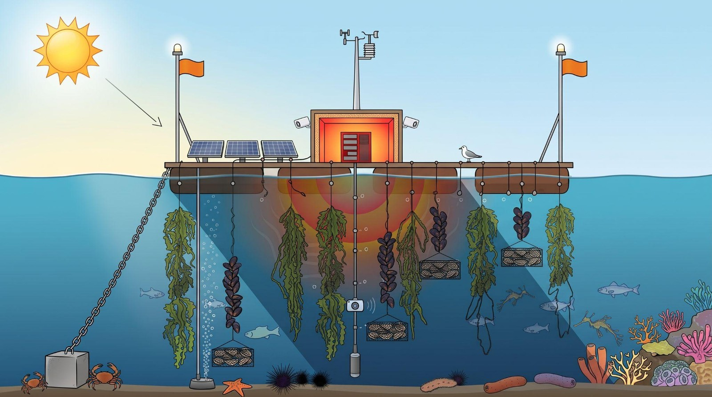
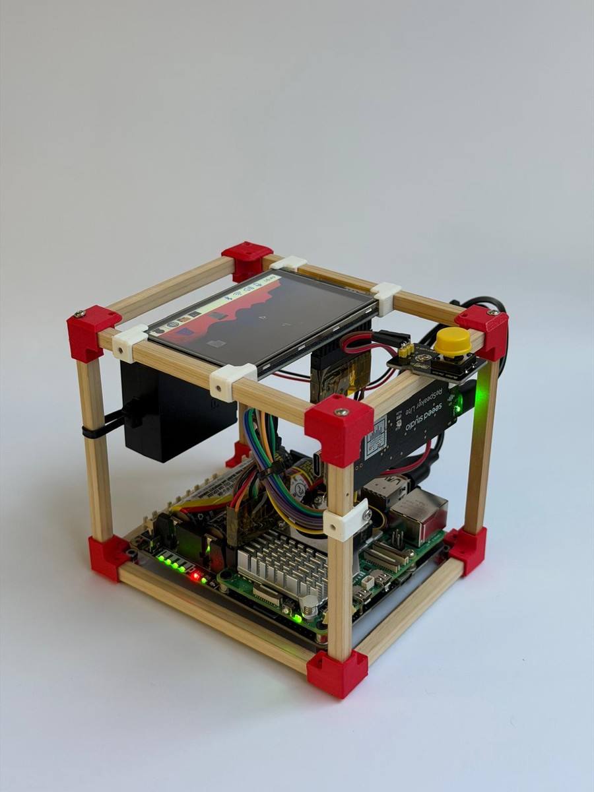

<!-- Editable source. To regenerate the self-contained HTML, run from this folder:
pandoc CEIBAL_JOINT_PROPOSAL.md --from=markdown --to=html5 --standalone --toc --toc-depth=2 --metadata pagetitle="From local energy to civic AI | Ceibal" --template=assets/report-template.html --css=assets/proposal.css --embed-resources --output=CEIBAL_JOINT_PROPOSAL.html
-->

# From local energy to civic AI

## Floating Solar Data Centres + CommonsClaw

**An educational and research collaboration to explore with Ceibal, Uruguay**  
Discussion document · 11 November 2026

> **The core question:** Can AI infrastructure be locally powered, ecologically regenerative, and understood, built, and governed by students and communities—rather than remaining an opaque, resource-intensive service in distant datacenters?
>
> **Two complementary research programmes:**
> - **Floating Solar Data Centres** (spearheaded by Cesar Harada) explores the physical and ecological frontier: can locally powered, water-cooled computing operate sustainably at sea and even improve marine habitat and biodiversity?
> - **CommonsClaw / Hierarchical Civic AI** (spearheaded by Alvaro Cassinelli) explores the civic and educational frontier: a bottom-up network of local AI nodes—each acting as *"the spirit of the place"*—that gives a conversational voice to an environment, reuses existing hardware, and builds shared community knowledge.
>
> **The invitation to Ceibal:** co-design a research-and-education collaboration in Uruguay bringing together **1. Port or marina access**, **2. Marine science**, and **3. Design & engineering** (Slide 9).[4](#ref-4) Through a shared **Land–Water Twin** experiment, students and educators can build and interrogate land-based sensor and AI nodes (reusing retired devices and measuring power) linked to the marine platform's observations.

Resumen ejecutivo en español (para compartir con equipos de Ceibal, ANEP, UTU, Udelar y contrapartes locales)

<strong>Propuesta de exploración conjunta:</strong> Invitamos a Ceibal a co-diseñar una iniciativa de investigación y educación que articula dos proyectos complementarios: <strong>Floating Solar Data Centres</strong> (liderado por Cesar Harada, enfocado en generación solar flotante, cómputo refrigerado por agua de mar y evaluación de impacto en la biodiversidad marina) y <strong>CommonsClaw / Hierarchical Civic AI</strong> (liderado por Alvaro Cassinelli, una arquitectura de inteligencia artificial cívica, local y descentralizada donde cada nodo actúa como el <em>«espíritu del lugar»</em>, dando voz al entorno a través de sensores y memoria comunitaria compartida).

<ul>
<li><strong>Tres roles complementarios en Uruguay (Slide 9):</strong> Buscamos articular (1) <strong>permiso de puerto o marina</strong> en aguas calmas con acceso en bote para inspección, (2) una <strong>institución de ciencias marinas</strong> (biología, química y física del agua, p. ej. CURE / Facultad de Ciencias – Udelar, IIBCE) y (3) <strong>socios de diseño, ingeniería y educación técnica</strong> (p. ej. Ceibal, CETP-UTU, UTEC, FING-Udelar).</li>
<li><strong>El puente pedagógico («Gemelo Tierra–Agua»):</strong> Mientras el equipo científico evalúa la plataforma flotante, docentes y estudiantes construyen y ponen a prueba nodos gemelos en tierra (huertas escolares, laboratorios o escuelas costeras) reutilizando dispositivos (en sintonía con <em>Ceibal Sostenible</em> y <em>EduIA Lab</em>), midiendo el consumo energético real y contrastando las explicaciones de la IA local con las mediciones ambientales de tierra y mar.</li>
<li><strong>Próximo paso:</strong> Una reunión exploratoria para definir el interés institucional, identificar contrapartes locales y acordar el alcance de un estudio de factibilidad conjunto, sin asumir compromisos financieros ni despliegues a gran escala de antemano.</li>
</ul>

**Reading guide:** Sections 1–9 present the executive discussion brief. Optional technical deep-dives follow in [Appendix A: CommonsClaw Architecture & the Local AI Landscape](#appendix-commonsclaw) and [Appendix B: Floating Solar Data Centres, Costs & Marine Assessment](#appendix-floating).

## 1. Why bring these projects together?

AI has a physical footprint and a governance model. It runs on equipment that requires electricity, cooling, materials, maintenance, and eventual replacement. It also raises questions about who owns the infrastructure, who controls data, and whose needs determine its use. The IEA identifies AI as a driver of growing datacentre electricity demand, while emphasizing uncertainty and the importance of efficiency.[1](#ref-1)

Providing access to an online AI service addresses only part of that picture. **Could people also learn to build, power, maintain, and govern a small part of the infrastructure themselves?**

The two projects approach this question from different directions:

| | Floating Solar Data Centres | CommonsClaw / Hierarchical Civic AI |
| --- | --- | --- |
| **Primary question** | Can locally powered floating computing infrastructure operate sustainably, and what effects does it have on the marine environment? | Can communities operate useful local AI, maintain shared knowledge, and cooperate without mandatory dependence on distant commercial cloud services? |
| **Main work** | Floating structures, solar energy, storage and cooling, environmental monitoring, and ecological assessment. | Local models, sensing, community memory, controlled information exchange, and distributed operation. |
| **Leadership and origins** | Spearheaded by Cesar Harada; builds on earlier floating energy and marine-science prototypes. | Concept and lead development by Alvaro Cassinelli, originating from the DLX/University of Tokyo SSAI prototype and collaboration around civic infrastructure. |
| **Relationship** | Could supply power and a physical host for nodes in the civic-AI architecture. | Could give communities access to local measurements and knowledge, including observations from a floating research platform. |

The physical project is not merely a container for AI, and CommonsClaw is not merely a dashboard for the floating platform. **They are distinct research programmes that can reinforce each other.** CommonsClaw can run on land; a floating platform can support other scientific or computing workloads.[2](#ref-2) [3](#ref-3)

**Power and data are different flows—and the network is both a service and a civic "probe."** The proposal does not assume that an offshore platform supplies electricity to distant schools: each site has its own suitable power arrangement, while the network exchanges approved information. Crucially, building a *geographically distributed system of experts* from the bottom up means the network operates simultaneously as a **local service provider** and as a **diagnostic probe**:

- **Revealing real local needs instead of deploying overkill:** As people and students interact with local nodes, the network organically reveals *where and who is asking what*, and what compute, sensors, or knowledge are genuinely needed in each locality—exposing both local bottlenecks and oversized, unnecessary solutions.[16](#ref-16)
- **Bottom-up resource balancing and public-policy insight:** Communities maintaining nodes naturally seek to minimize energy/compute waste or request capacity where real demand grows. Even more importantly, **reading the network's discovery index in reverse**—seeing where local nodes repeatedly have to reach out because knowledge, skills, or compute are missing in a locality—produces an empirical map of regional inequalities. That evidence can directly inform public-policy decisions on where to decentralize or centralize infrastructure, launch educational programmes, or target jobs, grants, and subsidies (expanded in [Appendix A3](#appendix-second-brain)).

## 2. The physical project: energy, computing, and marine ecology

Floating Solar Data Centres investigates an alternative physical setting for computing: floating solar generation, local energy management, and a marine environment in which cooling and ecological effects can be studied together. The broader project also explores hydrogen and other services; these are not prerequisites for Ceibal's initial educational work.

The supplied presentation describes an international programme of trials in planning—including a European marine-science test site in preparation with **Cnam-Intechmer (Cherbourg, France)**—and a history of prototypes beginning in 2021. The public project repository documents antecedents including the **Ocean Imagineer**, a floating oyster hatchery with solar power, and subsequent floating-energy experiments. These establish experience with components and field prototypes, while the proposed trials test whether a floating micro-datacentre can have a neutral or positive effect on marine biodiversity, comparable to artificial reefs.[2](#ref-2) [4](#ref-4)

### What the next experiments need to establish

- **Energy and operation:** electricity generated and consumed, storage needs, useful computing delivered, maintenance, and behaviour during poor weather or equipment failure.
- **Environmental effects:** temperature, shading, water conditions, and changes in organisms around the structure, assessed against suitable reference conditions.
- **Ecological possibility, not a promised result:** whether the installation can avoid harm and possibly improve habitat or biodiversity. Observing organisms on a structure alone would not establish an overall ecological benefit.

Slide 9 identifies biological, chemical, and physical assessment; slide 10 illustrates temperature probes at different depths, weather measurements, and above- and below-water observation. Marine scientists would need to define the study design, indicators, comparison sites, duration, and interpretation. Local renewable generation is not “zero electricity use”; seawater cooling is not “zero environmental impact.”[4](#ref-4)

**The marine-impact experiment is a central purpose of the proposed collaboration.** It requires complementary partners, not one institution doing everything. Ceibal's educational and technical participation can be designed alongside the scientific study, while marine specialists and site operators retain responsibility for their respective domains.

## 3. The civic-AI project: giving voice to a place

CommonsClaw proposes a network of small AI nodes associated with physical places: a school garden, a coastal observatory, a library, a technical workshop, or a neighbourhood plaza. Rather than acting as a private digital butler for one individual, each node is conceived as **"the spirit of the place"**—a design and pedagogical metaphor for an AI entity embodied in a specific environment that gives voice to local ecosystems, translates sensor telemetry into human narratives, and helps a community build shared knowledge and stewardship.[3](#ref-3) [16](#ref-16)

Sensors supply continuous observations; students, residents, and researchers contribute questions and field notes; curated local documents provide context. A small language model running directly on the node makes that material conversational while keeping the underlying record inspectable and correctable by people. When a question exceeds local knowledge or compute capacity, the node can consult peer places or a shared neighbourhood host rather than routing every everyday interaction to a distant commercial cloud.

This is a hierarchy of **knowledge, skills, and energy-aware task delegation**, not one monolithic model split across a low-bandwidth radio link. Each node remains useful to its local community even when upstream connectivity is absent.

{.node-photo}

### What exists, and what is still development work

| Existing evidence | What it does not yet establish |
| --- | --- |
| A Raspberry Pi 5 local-model prototype with phone/browser access over local Wi-Fi and streamed answers. | Reliable classroom-scale use, educational effectiveness, or compatibility with arbitrary retired computers and phones. |
| File-based identity and community notes, sensor digests, and logging/monitoring mechanisms. | Trustworthy long-term community memory, governance of multiple contributors, or cross-place synthesis. |
| A local microphone/transcription prototype and browser speech features. | A fully reliable offline voice interface. Browser dictation may depend on external services. |
| Real computer-health telemetry and a sensor-logger framework. | Validated environmental measurements or solar autonomy: the repository's solar-power logger is explicitly simulated. |

The first hierarchy—two place nodes exchanging approved information through a shared node—remains to be built and tested. So do robust permission controls, source-traceable memory consolidation, and a supported deployment process. The existing system is a useful starting point, not an already operational civic network.[5](#ref-5)

## 4. How Ceibal could participate: three complementary partner roles

Slide 9 asks for **research and education partners to evaluate the impact of a floating data centre on the marine environment**, structured around three complementary roles:[4](#ref-4)

| Partner role sought | Contribution described in the presentation | Illustrative Uruguayan counterparts to explore |
| --- | --- | --- |
| **1. Port authority / marina permission** | A calm-water berth or mooring where the floating prototype can be stationed and regularly inspected and maintained by boat. | National or municipal port/marina authorities (**ANP**, **DNH – Ministerio de Transporte y Obras Públicas**, municipal marinas, or yacht/nautical clubs along the Río de la Plata or Atlantic coast). |
| **2. Marine science institution** | **Biology:** biodiversity impacts (visual, acoustic, eDNA). **Chemistry:** dissolved oxygen, acidity, salinity. **Physics:** water temperature stratification and turbidity. | **CURE (Udelar)** in Maldonado/Rocha, **Facultad de Ciencias (Udelar)**, **IIBCE**, or **DINARA**. Uruguay's coast offers a natural gradient from the brackish **Río de la Plata** estuary to Atlantic marine waters. |
| **3. Design & Engineering institution** | **Design:** public engagement, flotation materials, physical platform, digital interfaces. **Engineering:** compute, sensors, IoT, edge AI, and hierarchical civic AI (CommonsClaw). | **Ceibal** (EduIA Lab, Ceibal Sostenible, Pensamiento Computacional), **CETP-UTU** (electronics, renewable energy, IT, and naval/maritime vocational tracks), **UTEC**, and **FING (Udelar)**. |

*Note: Institutional names above are illustrative examples for discussion; no prior commitment or endorsement is assumed.*

### Possible Ceibal contributions to discuss

- **Co-design the STEM and AI-literacy programme:** connect teacher-led activities to the experiment's real research questions, with age-appropriate participation, curriculum materials, and evaluation through **EduIA Lab**.
- **Lead the "Land–Water Twin" and circular-economy hardware track:** explore with **Ceibal Sostenible** and technical educators (for example in secondary schools or **CETP-UTU**) how retired tablets, laptops, or phones and micro:bit/ESP32 sensors can form land-based twin nodes that mirror the floating platform's telemetry schema.
- **Help convene the Uruguayan partner triangle:** facilitate introductions or a joint scoping roundtable with marine-science researchers, design/engineering faculties, and port or marina authorities.
- **Make scientific evidence and AI limits legible to learners:** create interfaces and classroom activities where students compare raw environmental measurements against local AI summaries, learning how sensors, energy budgets, and language models actually work.

These are open possibilities, not assigned duties. **Ceibal would not be presumed to grant marine permissions, fund offshore construction from its education budget, or operate marine vessels.** The first conversation is to identify which parts of this ecosystem Ceibal wishes to shape.

The potential value is shared across the ecosystem (Slide 9): for **students**, hands-on learning across ecology, electronics, energy, and AI; for **teachers and researchers**, interdisciplinary research, publications, and international collaboration; and for a **participating city or port**, open-source innovation in sustainable infrastructure and local technical capacity.[4](#ref-4)

### Existing foundations in Uruguay: students are already building this

- **Student precedent in water & coastal sensing (Premio NODO):** At Uruguay's national **Premio NODO** (MEC + ANEP + Ceibal), students from **Liceo N.° 4 in Soriano** won a distinction for building a **Floating Monitoring Station** (*Estación de Monitoreo Flotante*) to measure water parameters, and **School N.° 268 in Montevideo** was recognized for automated beach-warning sensors. Rather than introducing an alien concept, this collaboration scales and connects what Uruguayan students and teachers are already pioneering—linking their water sensors to local AI nodes and international marine research (including potential data exchange with the **Cnam-Intechmer** site in France).[6](#ref-6) [20](#ref-20)
- **AI education and regional leadership (EduIA Lab & IDB Hub):** Ceibal launched the regional **EduIA Lab** in March 2025, backed by an IDB technical cooperation (UR-T1361) consolidating it as a regional hub for responsible, people-centred AI in education, alongside Ceibal and ANEP's 2026 classroom tools (Gemini, NotebookLM, and PowerBuddy in CREA). CommonsClaw complements those cloud tools with a hands-on, local infrastructure layer.[6](#ref-6) [7](#ref-7)
- **Existing innovation channels (Fondos NODO) & physical computing:** Ceibal's micro:bit and computational-thinking programmes already connect sensors, programming, and student inquiry, while **Fondos NODO** provide an established national mechanism for school- and student-led innovation projects. Earlier Gluons work by Cassinelli and Daniel Saakes also explored spatial physical computing with an initial proposal/report for Ceibal in 2015–2017.[8](#ref-8) [9](#ref-9) [20](#ref-20)
- **Repair, circular economy, and 98% renewable electricity:** Ceibal Sostenible recovers and reuses or recycles over 75% of disused educational devices across repair centres nationwide, while Uruguay generated **98% of its electricity from renewable sources in 2025**. Together with Uruguay's National AI Strategy 2024–2030, this makes Uruguay a natural global reference for sustainable, locally governed AI.[10](#ref-10) [11](#ref-11) [20](#ref-20)

**The operational bridge between the two projects is the Land–Water Twin:** students and educators build land-based sensor-and-AI nodes (in a school garden, weather station, or coastal lab) using the same software and telemetry format as the floating platform, enabling direct comparison between land microclimates and marine data.

## 5. Start small: the Land–Water Twin in practice

Within the collaboration, the educational and CommonsClaw track can start with **two school or technical-education settings and one shared host**, linked to the floating platform's sensor protocol.

### A five-step learning and research sequence

| Activity | What learners and educators investigate | A tangible result |
| --- | --- | --- |
| **1. Give equipment a second useful life** | Which retired Ceibal tablet, laptop, or phone can safely serve as a browser terminal, sensor gateway, or local-model host? | A benchmarked hardware triage matrix and a working node built from reused and low-cost components. |
| **2. Instrument the place (Land–Water Twin)** | What do temperature, light, water, and power sensors actually measure? How do depth, shading, calibration, and missing data affect readings? | A calibrated land node (e.g., school garden or coastal lab) sharing the exact data schema of the floating platform's depth and weather probes. |
| **3. Talk with "the spirit of the place"—and verify it** | Can the local AI's conversational summary be traced to the underlying sensor log? Can students catch an unsupported claim? | A teacher-reviewed place journal separating raw measurements, community notes, and AI interpretation. |
| **4. Measure the energy cost of intelligence** | How many watt-hours does the node use while idle, logging, or answering a question? How much solar area and battery storage does that require? | A real energy budget comparing model sizes and hardware tiers—replacing abstract "green AI" claims with measured watts. |
| **5. Connect places and govern shared memory** | What local reports should be shared with another school or compared with the floating platform, and what stays local? | Two approved local narratives and a cross-site comparison (e.g., shaded vs. exposed temperature curves on land and in water). |

Laboratory and school-based activities can begin immediately—preparing sensors, testing retired devices, and building educational interfaces—while marine-science and port partners establish the calm-water berth and ecological baseline. Participation never requires students to work offshore: all hardware assembly, data analysis, and AI interaction take place safely in classrooms, workshops, or dockside visits.

### Circular economy is a research question, too

Old computers and phones are candidates, not interchangeable compute nodes. A device unable to run a useful model may still be a suitable interface or gateway. Another may be better repaired for its original purpose or recycled responsibly.

Selection should consider **ownership and authorization, secure erasure, operating-system support, memory, sustained performance, repairability, battery condition, and measured energy use**. Do not assume an old phone supports unattended operation or that its battery is safe to leave permanently charging.

The wider green-economy opportunity is to develop repair, maintenance, local energy, and technical-stewardship skills. Potential jobs or services are longer-term possibilities—not proven revenue, savings, or employment outcomes.

## 6. A development plan with two coordinated workstreams

### A. Define the joint experiment and partner responsibilities

Bring the three partner roles into the scoping discussion: identify a possible calm-water site and permission route, a marine-science lead, and design/engineering contributors. Agree the research question, Ceibal's chosen role, how learning activities connect to the experiment, and who will operate and maintain the platform. No site or institution is assumed to be committed.

### B. Develop the educational and civic-AI components

The software work is specific: a repeatable node setup; a reliable typed interface; Spanish-language evaluation; real sensor integration; source-linked, human-reviewed memory; and authenticated, permission-controlled exchange between two nodes and a shared host. Recovery, deletion, and disconnection behaviour must be tested, not left to a demonstration.

| Stage | Indicative active elapsed time | Decision gate |
| --- | --- | --- |
| **Define and audit** | 2–4 weeks | Select the learning activity; audit equipment; agree roles, data boundaries, support, and evaluation criteria. |
| **Build the bounded prototype** | A further 6–10 weeks | Demonstrate the selected sensors and node functions, controlled two-node exchange, and recovery from failures in the lab. |
| **Run a supervised experiment** | A further 8–12 weeks | Document learning, answer quality, energy use, equipment reliability, and teacher/support workload at the participating places. |
| **Review together** | A further 2–4 weeks | Decide to stop, revise, repeat, or expand; prepare a costed operating model if continuation is justified. |

**These are rough planning estimates, not commitments or measured averages from comparable projects.** The total is 18–30 active weeks if sequential. It assumes an available software lead with regular engineering support, educator participation, suitable equipment, and tightly bounded scope. Procurement, approvals, school calendars, extensive legacy-device adaptation, and marine work are not included.

### C. Prepare, deploy, and evaluate the floating experiment

In parallel with educational and software preparation, the physical workstream needs site and permission checks, engineering requirements, an ecological baseline and monitoring protocol, operating arrangements, and a funded maintenance plan. Deployment follows those approvals and readiness checks; a justified trial duration follows the scientific question and site conditions.

**No marine deployment date or budget is proposed here.** The educational timetable above is not a timetable for completing the marine study. Both workstreams should agree measurement formats, access to reviewed observations, and a joint research-and-education review from the outset.

### Build on existing tools; concentrate development on the missing parts

CommonsClaw already uses Ollama for local model serving. Home Assistant's staged local-voice work and Kolibri's offline educational delivery offer reusable engineering and deployment lessons. Model-routing research such as RouteLLM offers a technical precedent for selecting between capabilities. None provides ready-made community governance or proves this proposal's learning or environmental benefits.[12](#ref-12)

## 7. What participation would require

### People and responsibilities

For the educational workstream, discuss a **named software/integration lead with regular embedded-systems or deployment support**, an **education/co-design lead and participating teachers**, an **evaluation lead**, privacy/safeguarding input, and a **local custodian at each site**. Roles may overlap, but preparation, release time, maintenance, and review need explicit provision. Teachers should not silently inherit systems administration.

For the floating experiment, the partner group also needs **marine science, floating-system engineering, site operation and boat access for maintenance, and permissions/safety coordination**. Assign these explicitly to the appropriate partners; they cannot be presumed to be Ceibal's responsibilities.

### An illustrative equipment envelope

| Educational experiment | Conditional extensions—not prerequisites |
| --- | --- |
| Two place-node computers: reuse suitable devices where testing supports it; retain a known working reference platform. | Solar generation, safe storage, protection, and metering, sized from the measured load. |
| One shared host, benchmarked before deciding whether additional memory or a GPU is necessary. | A microphone and speaker after a clear voice requirement and reliability tests. |
| Browser access devices, one small calibrated sensor set per place, power metering, storage, enclosures, and spares. | LoRa devices, gateway or service access after a connectivity survey; marine equipment only under the separate research workstream. |

### Connectivity: existing leads, not an assumed national network

Local interaction can use Wi-Fi or Ethernet. Larger transfers and inter-site coordination need an authorized IP connection. **LoRa/LoRaWAN is appropriate for small sensor messages, not continuous voice or model downloads.** A radio link is neither the AI itself nor a guarantee of an available community network.[13](#ref-13)

Antel documents IoT expertise and an R&D kit with LoRa and NB-IoT modules. Separately, a 2022 supplier announcement describes a private LoRaWAN network planned for Montevideo's streetlighting, including provision for third-party services. These are useful leads to investigate; current coverage, permission, tariffs, equipment compatibility, and data-hosting arrangements still need confirmation. Neither establishes access for this proposal or national coverage.[14](#ref-14)

### Indicative division of contributions ("who brings what")

To be clear from the outset, **Ceibal is not being asked to fund offshore marine hardware out of its educational budget.** A balanced partnership can combine international R&D assets with existing Uruguayan educational and scientific channels:

| International project team (Cassinelli, Harada & international network) | Uruguayan partner ecosystem (Ceibal & local counterparts to explore) |
| --- | --- |
| **Floating Solar Data Centre IP & prototypes:** engineering lineage from sea trials (2021–2026) and sister scientific test protocol with **Cnam-Intechmer (France)**. | **Pedagogical co-design & school channels:** selecting pilot schools/clubs, teacher training, and alignment with **EduIA Lab / Hub** and **Fondos NODO**. |
| **CommonsClaw open-source stack & technical lead:** local LLM node software, sensor harness, shared memory architecture, and reference node kits. | **Circular-economy hardware triage:** testing candidate retired tablets/laptops/phones and battery-safety protocols with **Ceibal Sostenible** and **CETP-UTU**. |
| **International funding & research mobilisation:** co-authoring international ocean-impact, climate, and civic-AI grant proposals and joint publications. | **National ecosystem convening:** connecting a **marine-science lead** (e.g., CURE / Facultad de Ciencias), a **calm-water port/marina**, and national innovation instruments (e.g., **ANII**). |

### The budget conversation

There is no verified inventory or supplier quotation supporting a monetary total yet. Cost **engineering; educator preparation and release time; equipment and spares; installation/travel; connectivity; evaluation; and recurring support/replacement** separately, and cost the marine study on its own research track.

Compare device reuse with new off-the-shelf hardware (such as a Raspberry Pi 5 or modular ESP32 kits like Espressif's ESP-Mosaico) on total operating cost, safety, and useful life. A donated device is not automatically free to support; locally generated electricity does not remove capital or maintenance costs.

## 8. What would count as success?

Before starting, agree measurable criteria rather than assuming that a local AI is useful or sustainable.

- **Learning:** can participants explain the measurement-to-answer chain, identify unsupported AI claims, and describe where their data and computation go?
- **Additional value:** is the system more useful for the chosen activity than a sensor dashboard and teacher-curated notebook, or an existing institutional tool?
- **Resource use:** what are idle and active energy use, repair effort, useful device life, replacement needs, and total cost? Do not equate fewer cloud calls with a proven lower lifecycle footprint.
- **Local agency:** can authorized people inspect, correct, export, and delete shared knowledge; refuse an upstream transfer; and continue useful local work during disconnection?
- **Operational reality:** can the system recover, and can the responsible people maintain it within an acceptable workload?
- **Marine evidence:** what does the agreed scientific comparison show about the floating installation's effects, including adverse or inconclusive findings—not only favourable observations?

**Safeguards precede participation.** Determine responsibility for personal data, lawful basis and any required consent, retention, access, and deletion under Uruguay's framework and institutional requirements. Local storage alone is not privacy; a shared record or summary can still identify someone. The initial scope should exclude autonomous grading, student profiling, and consequential civic decisions.[15](#ref-15)

## 9. The conversation to open with Ceibal

1. **Participation:** which parts of this research-and-education collaboration would Ceibal like to help shape or develop?
2. **Partner group:** could Ceibal help connect a port/marina, a marine-science institution, and design/engineering contributors? What relationships or separate outreach would be needed?
3. **Joint experiment:** which marine-impact questions and associated STEM activities offer a useful starting point, and how should CommonsClaw support them?
4. **Feasibility and responsibility:** which site, permissions, expertise, equipment, and support could actually be secured, and by whom?
5. **Continuation:** what evidence would justify another stage, and who would maintain the result?

**The immediate goal is to establish interest in the collaboration, identify counterparts for the three partner roles, and jointly define feasibility and go/no-go criteria.** The longer-term vision is a bottom-up network of locally powered, community-governed AI infrastructure. A small, honest research-and-education experiment is how to find out which parts of that vision deserve to grow.

## Appendix A — CommonsClaw: motivation, nodes, and knowledge routing

*Technical background. The multi-node architecture below is proposed; the existing implementation is the local-node prototype described in Section 3.*

### A1. Why a community AI, rather than another chatbot?

The motivation is not simply to put a smaller model on cheaper hardware. It is to make **knowledge, computing, and their governance local enough for people to understand and influence them**. A place has measurements, history, practical needs, and community contributions that a general-purpose remote model does not automatically know.

The manifesto proposes a “geographically distributed mixture of experts”: different places develop different knowledge and cooperate when useful. This is an analogy for **independent models and knowledge stores coordinated across a network**, not a single neural network distributed across devices. The desired benefits—local relevance, resilience, community agency, and more proportionate resource use—must be tested rather than assumed.[16](#ref-16)

### A2. From IoT to civic AI: what belongs at each level?

**IoT** connects devices and observations. **AIoT** adds machine learning, for example to detect a pattern in a sensor signal. **Edge AI** describes where computation happens—near the source or user—not a separate rung that every system must implement. A simple logger needs no AI; a place node can add a local language model without replacing the sensor's basic functions.

| Level | Role in the proposed network | Illustrative equipment and output |
| --- | --- | --- |
| **0 — Sensing and embedded AIoT** | Record signals; optionally filter, classify, or detect events locally. | Sensors, microcontrollers (e.g., micro:bit, ESP32 / ESP-Mosaico), or logger processes; timestamped readings or defined events. Not every device needs a language model. |
| **1 — The place node ("spirit of the place")** | Give a conversational voice to one specific environment; combine local observations, selected documents, and community notes; maintain the place's inspectable record. | The current Pi 5 prototype, or a suitably tested alternative (including candidate reused devices); answers grounded in local material. |
| **2 — The neighbourhood/shared node** | Compare several places, consolidate approved reports, cache recurring knowledge and skills, and provide capabilities that an individual node cannot host alone. | A school, library, cooperative, or institutional host; cross-place synthesis and shared retrieval services. Hardware follows measured workloads, not a fixed GPU prescription. |
| **3+ — Wider institutional services** | Address questions requiring a broader geographic scope, specialist knowledge, or greater computing capability. | Municipal, national, specialist, and—when explicitly chosen—global services. Escalation is conditional, not the default destination of every interaction. |

This follows the current project documentation: **Level 2 is the first tier spanning several places**; older draft numbering varies. A floating platform is a possible physical host, not a level in itself. Its role depends on the model, knowledge, and services it can support.[16](#ref-16)

{.technical-diagram}

**People are participants and stewards, not another hardware tier.** Teachers, learners, residents, researchers, and maintainers can ask questions, contribute observations, challenge interpretations, and decide what enters shared memory. A phone may be only an interface; becoming a compute node requires separate compatibility and operating tests.

### A3. Beyond "DNS for AI": a collective "second brain" for knowledge, skills, compute, and energy

Early project notes used the shorthand *"DNS for AI"* to describe how a node finds out who knows what across the network. While useful as a first intuition, **a traditional DNS metaphor is too narrow**: classic DNS is a static phonebook that maps a name to an address. Knowing *where data sits* is only one dimension of a living civic network.

What CommonsClaw actually proposes is a **collective "second brain" and resource mesh** that coordinates four intertwined dynamics—staying as local as possible and reaching outward only when necessary, while simultaneously acting as a **service provider and a diagnostic probe**:[16](#ref-16)

1. **Epistemic Discovery ("Who knows what, and where?"):** When a question cannot be answered from a node's own sensors and memory, discovery locates which peer place or higher tier holds relevant ground-truth observations or verified domain knowledge (for example, connecting a school garden node with a nearby coastal station or agricultural school), together with its freshness and access terms.
2. **Compute and Energy Load-Balancing ("Where can this request be handled right now?"):** Unlike static directories, civic nodes run on heterogeneous hardware and local, time-varying renewable energy (such as solar panels and batteries). Routing weighs not only where data lives, but **where surplus solar power and idle compute capacity are currently available**—deferring or shifting heavier summarization and inference to a sunlit node, a floating solar host, or a mains-powered school server rather than draining a low-battery field node.
3. **Adaptive Knowledge Caching & Reinforcement ("Strengthening local memory through use"):** When a community or classroom repeatedly asks about a subject—or fetches external context—the distilled answers and supporting documents are **cached and reinforced locally**. Frequently used knowledge settles close to the people who need it (much like synaptic reinforcement in a shared second brain), progressively enriching the local database and cutting future network and energy costs.
4. **Concentration of Skills & Specialized Capabilities ("Where expertise crystallizes"):** Nodes accumulate not only passive text, but **reusable skills, analytical routines, and specialized tools** shaped by recurring local demands (for example, calibrating a turbidity probe, interpreting estuarine salinity shifts, or advising on local crops). Over time, each node develops distinct practical expertise—forming a genuine **geographically distributed mixture of experts**.

#### Reading the index in reverse: an empirical tool for public policy

Because this architecture grows from the bottom up, **analyzing the network's discovery and routing patterns in reverse becomes a high-value civic instrument.** Tracing what a locality asks for—and where local nodes repeatedly fail to find knowledge, skills, or compute capacity—exposes both oversized, unnecessary deployments and real regional gaps.

Anonymized, aggregate reports on the unequal distribution of knowledge, technical skills, or computing resources across neighbourhoods and regions can directly inform **democratic and public-policy decisions**: where to decentralize or centralize infrastructure, where to launch new educational or vocational programmes, and where to target public grants, subsidies, or local job creation.[16](#ref-16)

### A4. Inside one node: the existing mechanism and its next step

The current architecture deliberately separates processes and uses readable files:[17](#ref-17)

1. **Observations and contributions:** independent sensor loggers write local files; people can leave notes; identity and journal material supply context.
2. **A question arrives:** a browser, console, or voice frontend uses its own instance of the model-access helper. That helper builds a prompt containing selected local material.
3. **Local inference:** the frontend calls the separate Ollama service; the answer returns to that frontend. The live status file is operational state, not the community's durable memory.
4. **Proposed evolution:** a supervised interaction core with consistent events, plus controlled retrieval and inter-node interfaces. This target should not be confused with an already implemented central orchestrator.

The intended memory ladder is **readings → local reports → a reviewed account of the place → cross-place synthesis**. Today, accumulating files is ahead of reliably consolidating them. A model-generated interpretation must not silently become a community fact: sources, corrections, provenance, approval, and the ability to reverse a change are part of the development task.

### A5. What the first network should prove

Two place nodes and one shared host are enough to test the essential questions: can an answer cite its local evidence; can an approved report be compared across places; can a transfer be refused or revoked; and does useful local operation survive disconnection? LoRa can carry small observations, while richer inter-node exchanges use appropriate IP connectivity.

The pilot need not implement a nationwide discovery service, train a new foundation model, or automate consequential decisions. Its purpose is to establish the smallest useful, governable connection between **people, observations, local models, and shared knowledge**.

### A6. Why now: an exploding field of local AI—and how CommonsClaw compares with OpenClaw

Three years ago, running a conversational language model, voice transcription, and persistent agent memory on a solar-powered board or a repurposed tablet was impractical. Today, **local and edge AI is one of the fastest-moving frontiers in computing**, making this proposal timely and technically realistic:[21](#ref-21)

- **Compact, capable open-weight models:** Models in the 0.3B–3.8B parameter range—including **Gemma 3 270M** (Google DeepMind), **Llama 3.2 1B** (Meta), **SmolLM2 1.7B** (Hugging Face), **Qwen2.5 0.5B/1.5B**, and **Phi-3.5** (Microsoft)—deliver strong instruction-following and summarization within a few gigabytes of RAM.
- **Commodity edge runtimes & modular hardware:** C/C++ inference engines (**llama.cpp**, **Ollama**) run quantized models on ARM boards (Raspberry Pi 5) and repurposed Android devices, while modular microcontroller platforms (such as **Espressif's ESP-Mosaico** and ESP32-S3/C6) let students and coding agents build sensor-and-edge nodes from inexpensive off-the-shelf parts.
- **Cascaded and frugal routing:** Research such as **FrugalGPT** (Stanford), **RouteLLM** (UC Berkeley/LMSYS), and **Hybrid LLM** demonstrates that answering routine queries on small models and escalating only hard queries cuts inference cost and energy dramatically without sacrificing quality— confirmed quantitatively by **Power Hungry Processing** (Luccioni et al.) and tracked by tools like **CodeCarbon** and the **AI Energy Score**.
- **Local voice, agent memory, and open protocols:** Open voice stacks (**Home Assistant's "Year of the Voice"**, **Wyoming**, **Piper TTS**, **openWakeWord**, **faster-whisper**), hierarchical file-based agent memory (**MemGPT / Letta**), and interoperability standards (**Model Context Protocol / MCP**, **Agent2Agent / A2A**, **AGENTS.md**, and cryptographic agent workspaces such as Block's **Buzz**) provide ready-to-use building blocks, alongside decades of community-network governance from **guifi.net**, **NYC Mesh**, **Meshtastic**, and Berkeley's pioneering **Community Memory** project (1973).

#### CommonsClaw vs. OpenClaw: a commons, not a personal butler

Within this wave, **OpenClaw** (`openclaw/openclaw`) has emerged as the flagship open-source personal AI assistant: it runs on a user's own hardware, keeps Markdown memory files locally, performs nightly "dreaming" memory consolidation with deterministic score gates, and connects to personal chat channels. CommonsClaw deliberately borrows OpenClaw's best file-memory mechanics—while **inverting its topology and civic purpose**:[21](#ref-21)

| Dimension | OpenClaw (Personal AI Gateway) | CommonsClaw (Hierarchical Civic AI) |
| --- | --- | --- |
| **Whose memory and identity?** | **One individual user:** a private personal diary and assistant across WhatsApp, Telegram, or Slack; group sessions are excluded from durable memory. | **A place and its community:** shared, plural authorship where everyone interacting with the node contributes to one evolving local memory. |
| **Relationship to the physical world** | **Channel-first:** follows a person across digital messaging apps. | **Embodiment-first ("spirit of the place"):** anchored to a specific garden, school, park, or coastal platform; its sensors are its body. |
| **Topology** | **Flat:** one personal agent + plugins in a single trust domain. | **Federated hierarchy (Levels 0 → 1 → 2 → 3+):** each tier summarizes at its own scale and negotiates permissions across community boundaries. |
| **Core unsolved problem** | Personal productivity and tool orchestration for one owner. | **Civic governance:** whose voice counts in a shared memory, how a commons resists capture by its loudest visitor, and how communities share compute, energy, and knowledge. |

## Appendix B — Floating Solar Data Centres: physical system, costs, and environmental evidence

*Technical background. The diagram describes proposed functional relationships, not a construction specification or a demonstrated integrated installation.*

### B1. What the physical system brings together

The floating project examines the coupling of local energy production, computing, and a marine setting—not merely putting conventional servers in a waterproof box. Its wider research programme includes additional energy and water services, but those should not all be treated as requirements for the first Ceibal-related experiment.[2](#ref-2)

{.technical-diagram}

The principal components and questions are:

- **Energy:** photovoltaic generation, electrical protection, power management, and an agreed storage or backup arrangement. Useful operation depends on energy over time, not just the panel's peak rating.
- **Physical host:** flotation, mooring, computing enclosure, connections, access, and maintainability in the selected environment.
- **Cooling:** a designed thermal path and its interaction with surrounding water. Heat is transferred, not eliminated; the marine effect must be measured.
- **Observation and communication:** weather, energy, temperature and other environmental measurements, with suitable data transfer and locally inspectable records.
- **Wider research options:** hydrogen, water treatment, aquaculture, or other services described by the broader project. Their inclusion requires separate justification, expertise, safety review, and assessment of cumulative impacts.

The software role is complementary: CommonsClaw could help people explore reviewed evidence and link places, while deterministic equipment controls and professional operational oversight remain distinct from conversational AI.

### B2. Scale: do not confuse solar capacity, computing load, and energy

A photovoltaic rating in **kWp**, an IT load in **kW**, and daily consumption in **kWh** describe different things. A “10 kW” label is not enough to specify a datacentre.

Sizing should start with the **measured average total electrical load**, including computing, communications, conversion losses, and any active cooling or pumping. Daily demand is average load multiplied by operating hours; local solar yield and the desired operating schedule then inform generation and storage requirements. No continuous solar autonomy follows from matching panel peak power to server power.

Likewise, the civic-AI level does not impose a universal wattage. A small local node, a shared inference host, and a utility-scale facility have different service and reliability requirements. Prototype results cannot be extrapolated directly to national-scale infrastructure.

### B3. Datacentre costs and footprint: context, not a pilot budget

| Sourced context | What it does—and does not—tell us |
| --- | --- |
| The IEA's 2025 report estimates **415 TWh** of global datacentre electricity consumption in **2024**, about **1.5%** of global electricity use.[1](#ref-1) | This covers datacentres generally, not AI alone. It is a dated global baseline, not this project's consumption. |
| The same report projects around **945 TWh in 2030** in its Base Case.[1](#ref-1) | A scenario-dependent projection, not a measured outcome or an inevitable trajectory. |
| The IEA reports global datacentre investment of about **US$500 billion in 2024**, nearly double the 2022 level.[18](#ref-18) | This describes industry-wide investment. It is neither a unit construction price nor evidence that a floating installation will be cheaper. |
| UNCTAD identifies materials extraction, manufacturing, water and energy use, and device disposal as environmental pressures across digital infrastructure.[19](#ref-19) | Moving compute or changing its power source addresses only part of the lifecycle. Reuse, repair, transport, materials, and end-of-life treatment still matter. |

For the proposed floating experiment, the cost model needs four distinct groups:

1. **Capital:** design, fabrication, flotation/mooring, energy equipment, enclosure, computing, sensors, communications, and commissioning.
2. **Operations:** inspection and boat access, staffing, connectivity, cleaning, calibration, corrosion/biofouling management, insurance, and repairs.
3. **Research and education:** baseline studies, sampling and analysis, scientific interpretation, teaching preparation, interfaces, and reporting.
4. **Replacement and closure:** batteries and electronics where applicable, spares, removal, recycling, and site restoration.

The business case should compare a **defined service and availability level** against an appropriate land-based alternative. Lower land requirements or local solar generation do not automatically offset marine engineering and maintenance costs. The project's proposed income sources—computing, energy, or other services—are possibilities to evaluate, not established revenue. No per-node or per-MW price is justified by the evidence reviewed here.[2](#ref-2)

### B4. From environmental promise to a credible experiment

Slide 9's three domains provide a useful structure: biological observations, water chemistry, and physical conditions. Slide 10's shaded/exposed locations and temperature measurements at different depths are a proposed layout; the scientific partner must determine whether that design can answer the chosen question.[4](#ref-4)

| Question | Evidence needed |
| --- | --- |
| **Does the installation change local temperature or water conditions?** | Baseline and reference observations, operating state and load, weather and water movement, measurement uncertainty, and an appropriate sampling duration. |
| **Does it benefit or disturb marine life?** | A defined ecological question and suitable indicators; observations around the structure and comparison conditions. Colonisation or more visible organisms alone does not establish a net biodiversity gain. |
| **Does it reduce the overall resource footprint?** | Comparable computing service, measured energy, the source of electricity, direct and indirect water demand, material and transport burdens, useful life, and responsible disposal. |
| **Can it be maintained safely and affordably?** | Inspection and repair records, access requirements, material durability, downtime, and an agreed end-of-life plan. |

A small node's environmental signal may be difficult to distinguish from natural variation. An inconclusive result is not proof of no impact. Seawater cooling may reduce a particular freshwater-cooling requirement, but it does not demonstrate zero water use across manufacturing, operation, and any additional processes.

This is why the partnership in Section 4 is integral to the project: **the port/marina enables a viable site and access; marine science establishes what can be concluded; design and engineering make the system and its observations usable and maintainable.** Ceibal's educational contribution can connect these disciplines while keeping scientific evidence distinct from an AI-generated explanation.

## References and image provenance

Public institutional and technical references were checked on 10–11 November 2026. Project documents report the projects' own work and intentions; they are not independent evaluations. No reference establishes a new partnership, equipment allocation, service entitlement, or funding commitment.

**1. Energy context.** International Energy Agency, *Energy and AI* (2025), [Energy demand from AI](https://www.iea.org/reports/energy-and-ai/energy-demand-from-ai). Its datacentre-wide electricity estimates should not be presented as AI-only consumption or as lifecycle assessments.

**2. Floating infrastructure project.** Cesar Harada, [Floating Solar Hydrogen Data Center](https://github.com/cesarharada/Floating-Solar-Hydrogen-Data-Center). Project description, past prototypes, and proposed integration; includes both prototyped and speculative elements.

**3. CommonsClaw origins.** [Credits and Project History](https://github.com/alvarohub/CommonsClaw-a-distributed-hierarchical-civic-AI-infrastructure/blob/17baa3f0ce216119c368be26b99bfa6a5a87bbfd/CREDITS.md), pinned to reviewed revision `17baa3f`. Project-authored account.

**4. Supplied presentation and images.** *20261111 Floating Solar Data Centre - Alvaro Copy for Ceibal*, version 11 November 2026, by Alvaro Cassinelli and Cesar Harada. **Slide 9 defines the three-part research-and-education partnership request; slide 10 illustrates the proposed temperature, weather, and biodiversity monitoring setup.** Slides 1 and 5 provide the prototype photographs; slides 4 and 10 provide the conceptual marine monitoring diagram; the architecture and flow diagrams were drawn for this report.

**5. Prototype status.** CommonsClaw [Plan of Record](https://github.com/alvarohub/CommonsClaw-a-distributed-hierarchical-civic-AI-infrastructure/blob/17baa3f0ce216119c368be26b99bfa6a5a87bbfd/PLAN.md), [roadmap](https://github.com/alvarohub/CommonsClaw-a-distributed-hierarchical-civic-AI-infrastructure/blob/17baa3f0ce216119c368be26b99bfa6a5a87bbfd/docs/07-roadmap.md), [voice status](https://github.com/alvarohub/CommonsClaw-a-distributed-hierarchical-civic-AI-infrastructure/blob/17baa3f0ce216119c368be26b99bfa6a5a87bbfd/docs/03-interaction-and-voice.md), and [simulated solar logger](https://github.com/alvarohub/CommonsClaw-a-distributed-hierarchical-civic-AI-infrastructure/blob/17baa3f0ce216119c368be26b99bfa6a5a87bbfd/loggers/sensor_solarpower.py). Evidence of current implementation and unfinished acceptance criteria, not production readiness.

**6. EduIA Lab.** Presidency of Uruguay, [Ceibal presents the regional AI-in-education laboratory](https://www.gub.uy/presidencia/comunicacion/noticias/ceibal-presento-eduia-lab-primer-laboratorio-regional-inteligencia-artificial), 26 March 2025.

**7. Existing educational AI offer.** Presidency of Uruguay, [Ceibal and ANEP offer new AI tools for teachers](https://www.gub.uy/presidencia/comunicacion/noticias/inteligencia-artificial-docentes-estudiantes-ceibal-anep-nuevas-2026), 16 June 2026. Includes Gemini and NotebookLM; does not describe a locally hosted civic-AI network.

**8. Physical-computing education.** Ceibal EDUx, [Micro:bit en el aula](https://edux.ceibal.edu.uy/courses/course-v1:ceibal+CEIBAL4_C1+2/about), undated course description. Evidence of educational resources, not current enrolment or equipment availability.

**9. Earlier physical-computing connection.** Alvaro Cassinelli and Daniel Saakes, *Data Flow, Spatial Physical Computing*, TEI 2017, [DOI: 10.1145/3024969.3024978](https://doi.org/10.1145/3024969.3024978). The [Gluons project page](https://alvarocassinelli.com/gluons/) links an initial Ceibal proposal/report. This is historical context, not a current commitment.

**10. Circular-economy foundation.** Presidency of Uruguay, [Ceibal's electronic-waste recovery, repair, and recycling](https://www.gub.uy/presidencia/comunicacion/noticias/75-residuos-electronicos-ceibal-es-reutilizado), 3 June 2024.

**11. Policy context.** Agesic, [National Artificial Intelligence Strategy 2024–2030](https://www.gub.uy/agencia-gobierno-electronico-sociedad-informacion-conocimiento/comunicacion/publicaciones/estrategia-nacional-inteligencia-artificial-2024-2030), published 22 November 2024.

**12. Reusable precedents, not delivery estimates.** Home Assistant, [2023: Year of Voice](https://www.home-assistant.io/blog/2022/12/20/year-of-voice/), 20 December 2022, with subsequent release links; Learning Equality, [Kolibri User Guide](https://kolibri.readthedocs.io/en/latest/); Isaac Ong et al., [RouteLLM: Learning to Route LLMs with Preference Data](https://arxiv.org/abs/2406.18665), first submitted 26 June 2024. None validates the timetable, educational outcomes, or environmental benefits proposed here.

**13. Radio scope.** The Things Network, [What is LoRaWAN?](https://www.thethingsnetwork.org/docs/lorawan/what-is-lorawan/). Explains the distinction between LoRa radio modulation and the LoRaWAN protocol, and suitability for small payloads. Local equipment and spectrum requirements still need confirmation.

**14. Uruguayan connectivity leads.** Antel, [IoT overview](https://www.antel.com.uy/web/iot) and [Kit IoT Hardware](https://www.antel.com.uy/web/iot/w/kit-iot-hardware), undated. Actility, [Montevideo LoRaWAN streetlighting announcement](https://www.actility.com/uruguay-montevideo-lorawan-street-lighting/), 4 February 2022: a supplier's announcement of a private network, not a current access or coverage guarantee.

**15. Personal-data framework.** Uruguay, [Law No. 18.331](https://www.impo.com.uy/bases/leyes/18331-2008), promulgated 11 August 2008, with amendment references. A starting point for institutional legal review, not a compliance determination.

**16. Civic-AI motivation and hierarchy.** CommonsClaw [manifesto](https://github.com/alvarohub/CommonsClaw-a-distributed-hierarchical-civic-AI-infrastructure/blob/17baa3f0ce216119c368be26b99bfa6a5a87bbfd/TOWARDS_HIERARCHICAL_CIVIC_AI.md) and [current vision chapter](https://github.com/alvarohub/CommonsClaw-a-distributed-hierarchical-civic-AI-infrastructure/blob/17baa3f0ce216119c368be26b99bfa6a5a87bbfd/docs/01-vision.md). Appendix A uses the latter's level numbering. The supplied *CommonsClaw & Hierarchical Civic AI: Master Architecture & Vision Manual* (first draft, September 2026), Sections 1.3 and 2.1, introduces “DNS/RAG/whoknowwhat” and neighbourhood knowledge caching. This is a design analogy, not an implemented protocol or a settled deployment specification.

**17. Node implementation and target architecture.** CommonsClaw [Architecture: how a question becomes an answer](https://github.com/alvarohub/CommonsClaw-a-distributed-hierarchical-civic-AI-infrastructure/blob/17baa3f0ce216119c368be26b99bfa6a5a87bbfd/ARCHITECTURE.md), its [detailed node diagram](https://github.com/alvarohub/CommonsClaw-a-distributed-hierarchical-civic-AI-infrastructure/blob/17baa3f0ce216119c368be26b99bfa6a5a87bbfd/docs/architecture.svg), and the [target architecture chapter](https://github.com/alvarohub/CommonsClaw-a-distributed-hierarchical-civic-AI-infrastructure/blob/17baa3f0ce216119c368be26b99bfa6a5a87bbfd/docs/02-architecture.md). The current frontend processes and file-based context are distinct from the proposed supervised core and inter-node services.

**18. Investment context.** IEA, *Energy and AI*, [Executive summary](https://www.iea.org/reports/energy-and-ai/executive-summary), 2025. Reports global datacentre investment of half a trillion dollars in 2024; this is not a quotation for floating infrastructure.

**19. Lifecycle and circularity.** UN Trade and Development (UNCTAD), [Digital Economy Report 2024: Shaping an environmentally sustainable and inclusive digital future](https://unctad.org/publication/digital-economy-report-2024). Broader digital-economy evidence, not a lifecycle assessment of either proposed project.

**20. Uruguayan student precedents, regional hub, and renewable matrix.** Presidency of Uruguay, [Premio NODO recognition including Liceo N.° 4 (Soriano) "Floating Monitoring Station" and School N.° 268 (Montevideo) beach-warning sensors](https://www.gub.uy/presidencia/comunicacion/noticias/comunidades-educativas-todo-pais-fueron-reconocidas-sus-proyectos-innovadores); Inter-American Development Bank (IDB), [UR-T1361: Consolidating the Regional AI-in-Education Hub (EduIA Hub)](https://www.iadb.org/es/proyecto/UR-T1361); Ministry of Industry, Energy and Mining (MIEM), [Uruguay maintains 98% renewable electricity generation](https://www.gub.uy/ministerio-industria-energia-mineria/comunicacion/noticias/uruguay-mantiene-su-alta-renovabilidad-generacion-electrica); and Cnam-Intechmer (Cherbourg), [Institut national des sciences et techniques de la mer](https://www.intechmer.cnam.fr/).

**21. Local/edge AI ecosystem and OpenClaw comparison.** CommonsClaw, [Verified References](https://github.com/alvarohub/CommonsClaw-a-distributed-hierarchical-civic-AI-infrastructure/blob/17baa3f0ce216119c368be26b99bfa6a5a87bbfd/REFERENCES.md) and [CommonsClaw vs OpenClaw](https://github.com/alvarohub/CommonsClaw-a-distributed-hierarchical-civic-AI-infrastructure/blob/17baa3f0ce216119c368be26b99bfa6a5a87bbfd/COMMONSCLAW_VS_OPENCLAW.md), citing: [OpenClaw](https://github.com/openclaw/openclaw); [FrugalGPT](https://arxiv.org/abs/2305.05176) (Chen et al., 2023); [Hybrid LLM](https://arxiv.org/abs/2404.14618) (Ding et al., 2024); [Gemma 3 270M](https://developers.googleblog.com/en/introducing-gemma-3-270m/); [Llama 3.2 1B](https://huggingface.co/meta-llama/Llama-3.2-1B); [SmolLM2](https://arxiv.org/abs/2502.02737); [Phi-3 / 3.5](https://arxiv.org/abs/2404.14219); [Qwen2.5](https://arxiv.org/abs/2412.15115); [llama.cpp](https://github.com/ggml-org/llama.cpp); [Ollama](https://github.com/ollama/ollama); [Espressif ESP-Mosaico](https://www.espressif.com/en/news/ESP_Mosaico_Release); [MemGPT](https://arxiv.org/abs/2310.08560) & [Letta Context Repositories](https://www.letta.com/); [Model Context Protocol (MCP)](https://modelcontextprotocol.io/); [Agent2Agent (A2A)](https://a2a-protocol.org/); [AGENTS.md](https://agents.md/); [Block Buzz](https://block.xyz/inside/introducing-buzz-where-humans-and-agents-work-together); [guifi.net](https://doi.org/10.1016/j.comnet.2015.07.009) (Baig et al., 2015); [NYC Mesh](https://www.nycmesh.net/); [Power Hungry Processing](https://arxiv.org/abs/2311.16863) (Luccioni et al., 2024); [AI Energy Score](https://huggingface.co/AIEnergyScore); and [CodeCarbon](https://codecarbon.io/).
